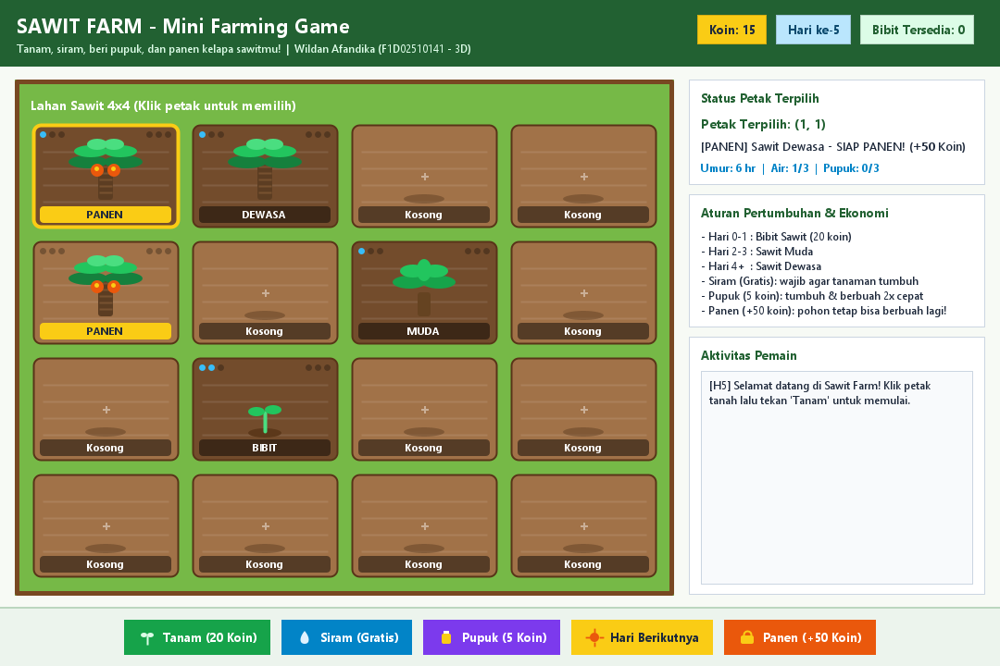
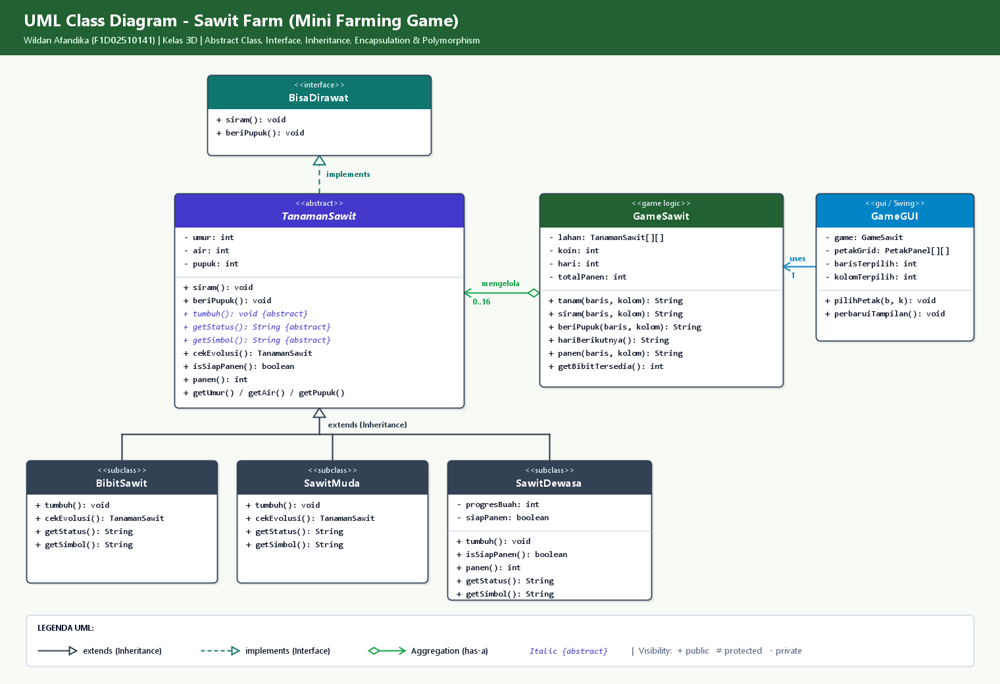

# Sawit Farm — Mini Farming Game (OOP Java Swing)

**Sawit Farm** adalah game simulasi 2D sederhana bertema menanam kelapa sawit yang dibuat menggunakan **Java Swing** untuk mempelajari dan mempraktikkan konsep **Object-Oriented Programming (OOP)** dengan cara yang interaktif dan mudah dipahami.

---

## 1. Identitas Mahasiswa

- **Nama** : Wildan Afandika
- **NIM** : F1D02510141
- **Kelas** : 3D
- **Mata Kuliah** : Pemrograman Berorientasi Objek (PBO)

---

## 2. Deskripsi Singkat Game

Pemain berperan sebagai petani kelapa sawit yang memiliki lahan **4×4** (16 petak). Di setiap petak, pemain bisa menanam bibit sawit, menyiram, memberi pupuk, mempercepat waktu ke hari berikutnya, lalu memanen tandan buah sawit saat pohon sudah dewasa untuk mengumpulkan koin dan memperluas kebun.

---

## 3. Cara Bermain

1. **Modal Awal**: Pemain mulai dengan **100 koin** di **Hari ke-1**.
2. **Klik Petak Lahan**: Klik salah satu petak di grid 4×4 (petak yang dipilih ditandai bingkai kuning).
3. **Tanam (20 Koin)**: Menanam `BibitSawit` baru pada petak tanah kosong.
4. **Siram (Gratis)**: Menambah kadar air tanaman (ditandai titik biru di pojok kiri atas petak). Tanaman **harus memiliki air** agar bisa tumbuh saat berganti hari.
5. **Pupuk (5 Koin)**: Menambah pupuk (titik kuning di pojok kanan atas petak) agar tanaman **tumbuh dan berbuah 2× lebih cepat**.
6. **Hari Berikutnya**: Memajukan permainan 1 hari sehingga semua tanaman di lahan berkembang:
   - **Hari 0–1**: Bibit Sawit (`BibitSawit`)
   - **Hari 2–3**: Sawit Muda (`SawitMuda`)
   - **Hari 4+**: Sawit Dewasa (`SawitDewasa`), lalu menghasilkan buah hingga status **SIAP PANEN** (buah oranye-merah muncul di pohon).
7. **Panen (+50 Koin)**: Memanen sawit dewasa yang siap panen untuk mendapatkan **+50 koin**. Pohon tetap ada di lahan dan bisa berbuah lagi setelah dirawat kembali!

*(Catatan: Angka hari, biaya, dan koin dibuat sederhana khusus untuk mekanisme game.)*

---

## 4. Screenshot Game



---

## 5. Class Diagram UML



Struktur file proyek:
```text
SawitSimulator/
├── src/
│   ├── Main.java            # Menjalankan game di Swing Event Dispatch Thread
│   ├── BisaDirawat.java     # Interface perawatan (siram & beriPupuk)
│   ├── TanamanSawit.java    # Abstract class induk seluruh tanaman sawit
│   ├── BibitSawit.java      # Subclass tahap bibit (Hari 0-1)
│   ├── SawitMuda.java       # Subclass tahap sawit muda (Hari 2-3)
│   ├── SawitDewasa.java     # Subclass tahap sawit dewasa & panen (Hari 4+)
│   ├── GameSawit.java       # Logika grid 4x4, koin, hari, dan aksi game
│   └── GameGUI.java         # Tampilan 2D Java Swing (grid, ilustrasi, tombol)
├── docs/
│   ├── class-diagram.png    # Gambar Class Diagram UML
│   ├── class-diagram.puml   # Sumber PlantUML
│   └── screenshot-game.png  # Screenshot tampilan game
└── README.md
```

---

## 6. Penjelasan Abstract Class dan Abstract Method

**Abstract Class** adalah class cetakan (blueprint) yang **tidak bisa dibuat objeknya secara langsung** (`new TanamanSawit()` akan error). Di proyek ini, `TanamanSawit` menyimpan atribut bersama yang bersifat `private` (**Encapsulation**): `umur`, `air`, dan `pupuk`.

**Abstract Method** adalah method tanpa isi di `TanamanSawit` yang **wajib diisi** oleh setiap class anak karena tiap tahap sawit punya cara tumbuh dan tampilan berbeda:

```java
// src/TanamanSawit.java
public abstract class TanamanSawit implements BisaDirawat {
    private int umur;
    private int air;
    private int pupuk;

    public abstract void tumbuh();
    public abstract String getStatus();
    public abstract String getSimbol();
}
```

---

## 7. Penjelasan Inheritance (Pewarisan)

**Inheritance** memungkinkan subclass mewarisi atribut dan method dari `TanamanSawit` menggunakan kata kunci `extends`, sehingga tidak perlu menulis ulang `umur`, `air`, `pupuk`, `siram()`, dan `beriPupuk()`:

- `BibitSawit extends TanamanSawit` — tahap awal (Hari 0–1), naik ke `SawitMuda` saat `umur >= 2`.
- `SawitMuda extends TanamanSawit` — tahap menengah (Hari 2–3), naik ke `SawitDewasa` saat `umur >= 4`.
- `SawitDewasa extends TanamanSawit` — tahap matang (Hari 4+), punya tambahan atribut `progresBuah` dan `siapPanen`, serta bisa dipanen berulang kali (+50 koin).

```java
// src/BibitSawit.java
public class BibitSawit extends TanamanSawit {
    @Override
    public TanamanSawit cekEvolusi() {
        if (getUmur() >= 2) {
            return new SawitMuda(getUmur(), getAir(), getPupuk());
        }
        return this;
    }
}
```

---

## 8. Penjelasan Polymorphism

**Polymorphism** berarti satu referensi bertipe induk (`TanamanSawit`) bisa menampung objek dari berbagai subclass (`BibitSawit`, `SawitMuda`, `SawitDewasa`) dan menjalankan method (`tumbuh()`, `getStatus()`, `getSimbol()`) sesuai tipe objek aslinya lewat **Method Overriding**.

Di `GameSawit.java`, seluruh petak lahan disimpan sebagai `TanamanSawit[][] lahan`:

```java
// src/GameSawit.java
TanamanSawit tanaman = lahan[b][k];

// Memanggil tumbuh() sesuai jenis objek aslinya (BibitSawit / SawitMuda / SawitDewasa)
tanaman.tumbuh();

// Jika sudah cukup umur, objek berevolusi ke subclass berikutnya
TanamanSawit hasilEvolusi = tanaman.cekEvolusi();
if (hasilEvolusi != tanaman) {
    lahan[b][k] = hasilEvolusi;
}
```

Di `GameGUI.java`, teks status dan visual 2D petak juga langsung memanggil `tanaman.getStatus()` dan `tanaman.getSimbol()` melalui referensi `TanamanSawit`.

---

## 9. Penjelasan Interface

**Interface** adalah kontrak daftar method yang harus disediakan oleh suatu class. Di proyek ini terdapat interface `BisaDirawat`:

```java
// src/BisaDirawat.java
public interface BisaDirawat {
    void siram();
    void beriPupuk();
}
```

`TanamanSawit` mengimplementasikan `BisaDirawat` (`implements BisaDirawat`), sehingga semua turunannya otomatis bisa disiram dan diberi pupuk melalui referensi `BisaDirawat` di `GameSawit.java`:

```java
// src/GameSawit.java
BisaDirawat dirawat = tanaman;
dirawat.siram();
```

---

## 10. Cara Menjalankan Game

Pastikan Java (JDK) sudah terpasang di komputer.

### Windows (PowerShell)
```powershell
New-Item -ItemType Directory -Force -Path out | Out-Null
javac -encoding UTF-8 -d out src\*.java
java -cp out Main
```

### Linux / macOS (Bash)
```bash
mkdir -p out
javac -encoding UTF-8 -d out src/*.java
java -cp out Main
```
