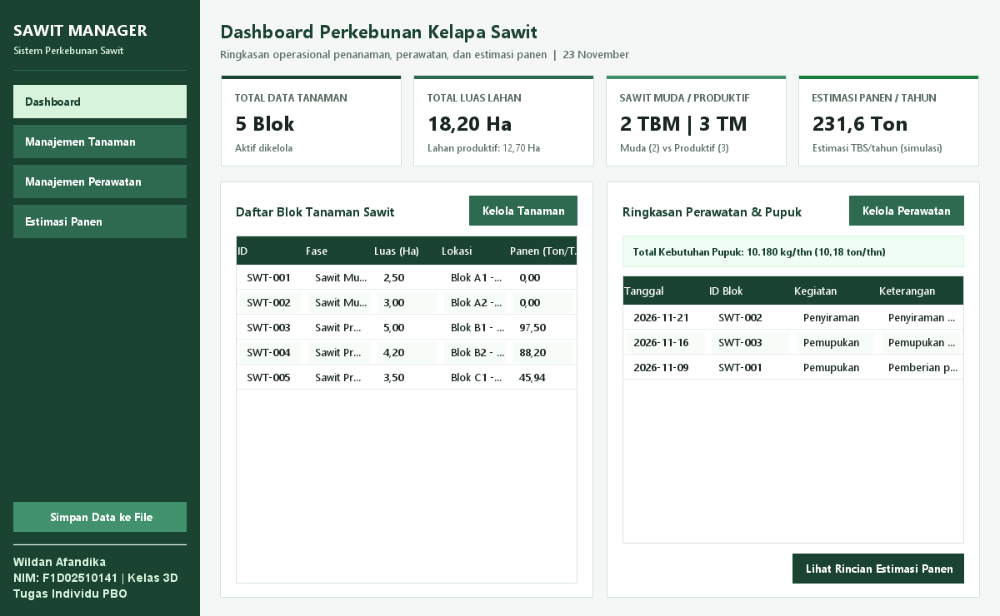
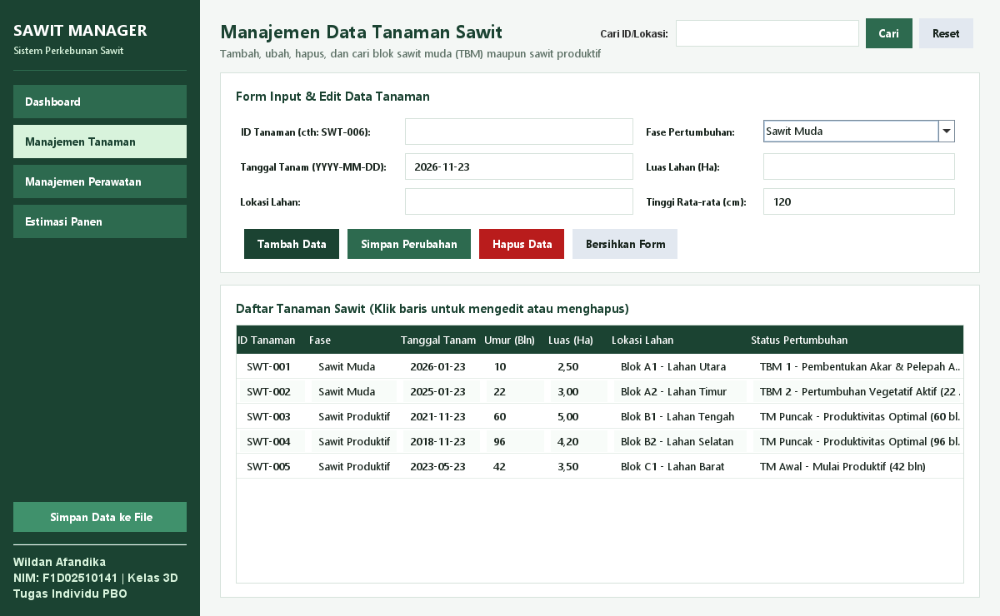
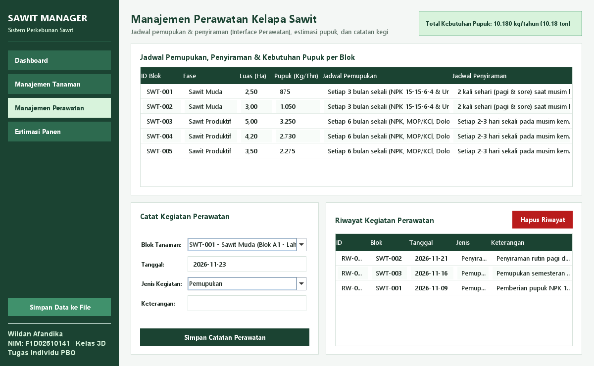
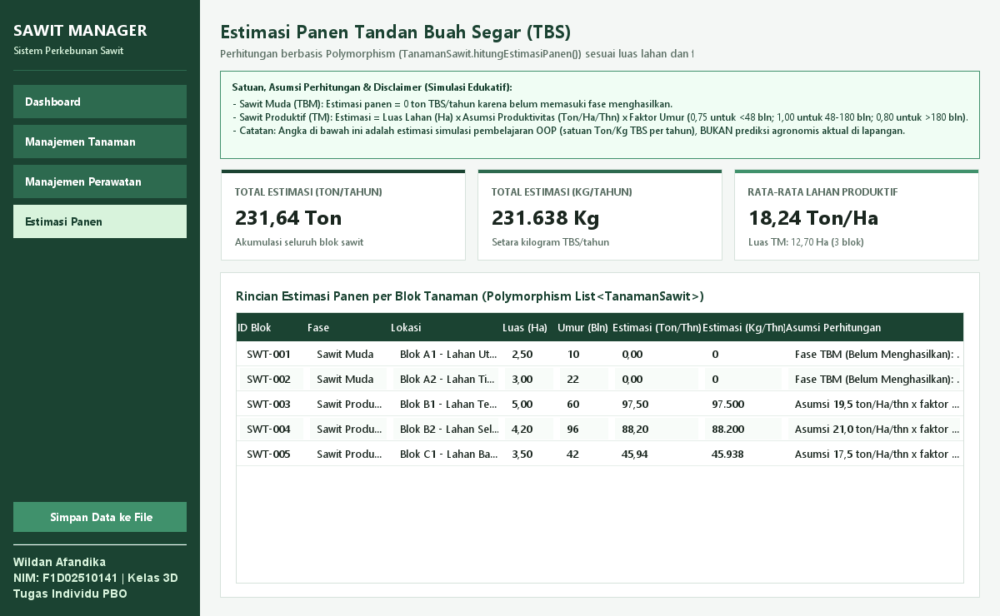

# Sistem Manajemen Perkebunan Kelapa Sawit (Sawit Management System)

Aplikasi desktop berbasis **Java Swing** untuk pengelolaan penanaman, perawatan, dan estimasi panen perkebunan kelapa sawit yang dirancang guna menerapkan prinsip **Object-Oriented Programming (OOP)** secara nyata, terstruktur, dan mudah dijalankan tanpa database eksternal.

---

## 1. Identitas Mahasiswa

- **Nama** : Wildan Afandika
- **NIM** : F1D02510141
- **Kelas** : 3D
- **Mata Kuliah** : Pemrograman Berorientasi Objek (PBO)
- **Studi Kasus** : Pengelolaan Penanaman, Perawatan, dan Panen Kelapa Sawit

---

## 2. Tujuan Pengembangan Aplikasi

1. Menerapkan konsep inti OOP (**Abstract Class**, **Abstract Method**, **Interface**, **Inheritance**, **Polymorphism**, **Encapsulation**, dan **Method Overriding**) dalam satu studi kasus nyata yang utuh.
2. Menyediakan antarmuka desktop yang rapi, intuitif, dan responsif untuk mencatat blok tanaman sawit (fase muda/TBM dan fase produktif/TM), jadwal & riwayat perawatan, serta simulasi estimasi panen.
3. Menerapkan pemisahan tanggung jawab (*separation of concerns*) antara lapisan **model**, **interface**, **service**, **repository (penyimpanan lokal)**, dan **GUI**.

---

## 3. Teknologi yang Digunakan

- **Bahasa Pemrograman**: Java (JDK 17+ / diuji pada JDK 26)
- **Antarmuka Pengguna (GUI)**: Java Swing (`JFrame`, `CardLayout`, `BorderLayout`, `GridBagLayout`, `JTable`, `JOptionPane`)
- **Penyimpanan Lokal**: File teks terstruktur (`CSV` dengan pemisah `|`) di folder `data/` menggunakan `java.nio.file` (tanpa database eksternal)
- **Dokumentasi UML**: PlantUML (`docs/class-diagram.puml`) dan gambar PNG (`docs/class-diagram.png`)

---

## 4. Fitur Aplikasi

1. **Dashboard**
   - Menampilkan statistik dalam bentuk kartu (*stat cards*): total blok tanaman, total luas lahan (Ha), komposisi Sawit Muda (TBM) vs Sawit Produktif (TM), dan total estimasi panen tahunan.
   - Menampilkan tabel ringkas tanaman, ringkasan total kebutuhan pupuk tahunan, riwayat perawatan terbaru, dan tombol navigasi cepat.
2. **Manajemen Tanaman (CRUD & Pencarian)**
   - Menambah, melihat, mengedit, dan menghapus data blok tanaman sawit (`SawitMuda` dan `SawitProduktif`).
   - Validasi input otomatis (ID tidak boleh kosong/duplikat, luas lahan > 0, format tanggal `YYYY-MM-DD`, parameter khusus dalam rentang wajar).
   - Pencarian cepat berdasarkan **ID Tanaman** atau **Lokasi Lahan**.
   - Dialog konfirmasi sebelum menghapus data serta notifikasi sukses/gagal.
3. **Manajemen Perawatan**
   - Menampilkan jadwal pemupukan, jadwal penyiraman (dari interface `Perawatan`), dan estimasi kebutuhan pupuk tahunan per blok.
   - Form pencatatan kegiatan perawatan (Pemupukan/Penyiraman) dan tabel riwayat perawatan yang dapat dihapus dengan konfirmasi.
4. **Estimasi Panen**
   - Menghitung estimasi panen (satuan **Ton TBS/tahun** dan **Kg TBS/tahun**) secara polimorfik melalui `TanamanSawit.hitungEstimasiPanen()`.
   - Menyertakan panel penjelasan satuan, rumus asumsi simulasi, dan catatan bahwa nilai bersifat **simulasi edukatif (bukan prediksi agronomis aktual)**.
5. **Penyimpanan Data Lokal**
   - Data tanaman (`data/tanaman_sawit.csv`) dan riwayat perawatan (`data/riwayat_perawatan.csv`) tersimpan otomatis saat perubahan terjadi dan dimuat kembali saat aplikasi dibuka.
   - Penanganan aman apabila file belum ditemukan atau terdapat baris rusak/korup (baris rusak dilewati dengan notifikasi peringatan tanpa membuat aplikasi crash).

---

## 5. Struktur Folder

```text
Sawit-Management-System/
├── src/
│   ├── Main.java                       # Entry point aplikasi Swing
│   ├── interfaces/
│   │   └── Perawatan.java              # Interface kontrak penjadwalan perawatan
│   ├── model/
│   │   ├── TanamanSawit.java           # Abstract class dasar tanaman sawit
│   │   ├── SawitMuda.java              # Subclass fase TBM (belum menghasilkan)
│   │   ├── SawitProduktif.java         # Subclass fase TM (menghasilkan/panen)
│   │   └── RiwayatPerawatan.java       # Model catatan riwayat kegiatan perawatan
│   ├── repository/
│   │   └── PenyimpananData.java        # Baca/tulis file lokal CSV + validasi
│   ├── service/
│   │   └── ManajemenSawit.java         # Logika bisnis, CRUD, agregasi polimorfik
│   └── gui/
│       ├── TemaUI.java                 # Palet warna sawit, font, & helper komponen
│       ├── MainFrame.java              # Frame utama (Sidebar + CardLayout)
│       ├── DashboardPanel.java         # Halaman Dashboard statistik
│       ├── TanamanPanel.java           # Halaman CRUD & pencarian tanaman
│       ├── PerawatanPanel.java         # Halaman jadwal, pupuk & riwayat perawatan
│       └── PanenPanel.java             # Halaman simulasi estimasi panen
├── docs/
│   ├── class-diagram.png               # Gambar Class Diagram UML
│   ├── class-diagram.puml              # Sumber PlantUML
│   └── screenshots/                    # Screenshot 4 halaman GUI aplikasi
├── data/
│   ├── tanaman_sawit.csv               # Penyimpanan lokal data tanaman
│   └── riwayat_perawatan.csv           # Penyimpanan lokal riwayat perawatan
├── README.md
└── .gitignore
```

---

## 6. Class Diagram UML


**Penjelasan Diagram:**
- `Perawatan` (`<<interface>>`) diimplementasikan oleh `TanamanSawit` (garis putus-putus dengan panah segitiga kosong).
- `TanamanSawit` (`<<abstract>>`) menjadi induk dari `SawitMuda` dan `SawitProduktif` melalui hubungan *inheritance* (`extends`, garis solid panah segitiga kosong).
- `ManajemenSawit` menyimpan koleksi polimorfik `List<TanamanSawit>` dan `List<RiwayatPerawatan>` (agregasi `0..*`), serta menggunakan `PenyimpananData` untuk persistensi lokal.
- `MainFrame` beserta keempat panel GUI menggunakan `ManajemenSawit` sebagai penghubung antara antarmuka pengguna dan logika bisnis.

---

## 7. Penjelasan Konsep OOP pada Source Code

### A. Abstract Class (`model.TanamanSawit`)
`TanamanSawit` dideklarasikan sebagai `public abstract class TanamanSawit implements Perawatan`. Class ini tidak bisa diinstansiasi langsung (`new TanamanSawit(...)` dilarang oleh compiler), melainkan menjadi kerangka dasar yang menyimpan atribut umum (`idTanaman`, `tanggalTanam`, `luasLahan`, `lokasiLahan`) dan method `getUmurBulan()`.

### B. Abstract Method (`TanamanSawit`)
Tiga abstract method utama yang wajib diimplementasikan oleh setiap subclass:
- `hitungEstimasiPanen()` — menghitung estimasi panen TBS (ton/tahun).
- `getStatusPertumbuhan()` — menjelaskan status fase pertumbuhan berdasarkan umur.
- `hitungKebutuhanPupuk()` — menghitung estimasi kebutuhan pupuk tahunan (kg/tahun).

### C. Interface (`interfaces.Perawatan`)
`Perawatan` mendefinisikan kontrak perilaku perawatan kebun:
- `jadwalkanPemupukan()`
- `jadwalkanPenyiraman()`

Dengan interface ini, `PerawatanPanel` dan `ManajemenSawit` dapat mengakses jadwal perawatan melalui referensi tipe `Perawatan` secara seragam tanpa bergantung pada detail internal masing-masing fase tanaman.

### D. Inheritance (`SawitMuda` & `SawitProduktif`)
- `SawitMuda extends TanamanSawit` merepresentasikan fase Tanaman Belum Menghasilkan (TBM) dengan atribut khusus `tinggiRataRataCm`.
- `SawitProduktif extends TanamanSawit` merepresentasikan fase Tanaman Menghasilkan (TM) dengan atribut khusus `targetTonPerHa` dan perhitungan faktor umur (`getFaktorUmur()`).

### E. Method Overriding
Kedua subclass meng-override seluruh abstract method dan method interface `Perawatan` dengan perilaku berbeda:
- `SawitMuda.hitungEstimasiPanen()` mengembalikan `0.0` (belum menghasilkan TBS), sedangkan `SawitProduktif.hitungEstimasiPanen()` menghitung `luasLahan * targetTonPerHa * faktorUmur`.
- `SawitMuda.hitungKebutuhanPupuk()` memakai asumsi dosis vegetatif `350 kg/Ha/thn`, sedangkan `SawitProduktif` memakai asumsi dosis produktif `650 kg/Ha/thn`.
- `jadwalkanPemupukan()` dan `jadwalkanPenyiraman()` memberikan jadwal yang spesifik sesuai fase muda atau produktif.

### F. Polymorphism (`service.ManajemenSawit` & `gui.*`)
`ManajemenSawit` menyimpan seluruh objek tanaman dalam satu koleksi `List<TanamanSawit>`. Ketika `getTotalEstimasiPanen()`, `getTotalKebutuhanPupuk()`, `PanenPanel.refreshData()`, atau `PerawatanPanel.refreshData()` melakukan iterasi atas `List<TanamanSawit>`, Java secara dinamis (*dynamic dispatch*) memanggil implementasi milik `SawitMuda` atau `SawitProduktif` sesuai tipe objek aktualnya.

### G. Encapsulation
Seluruh atribut pada `TanamanSawit`, `SawitMuda`, `SawitProduktif`, dan `RiwayatPerawatan` menggunakan modifier `private`. Perubahan nilai dilakukan lewat constructor dan setter yang memvalidasi data (menolak nilai kosong, negatif, tanggal di masa depan, atau karakter pemisah CSV).

---

## 8. Cuplikan Kode Penting

### Abstract Class & Abstract Method (`src/model/TanamanSawit.java`)
```java
public abstract class TanamanSawit implements Perawatan {
    private String idTanaman;
    private LocalDate tanggalTanam;
    private double luasLahan;
    private String lokasiLahan;

    public abstract double hitungEstimasiPanen();
    public abstract String getStatusPertumbuhan();
    public abstract double hitungKebutuhanPupuk();
}
```

### Method Overriding pada Subclass (`src/model/SawitProduktif.java`)
```java
@Override
public double hitungEstimasiPanen() {
    // Rumus estimasi simulasi: Luas (Ha) x Asumsi Ton/Ha/Thn x Faktor Umur
    return getLuasLahan() * targetTonPerHa * getFaktorUmur();
}

@Override
public String jadwalkanPemupukan() {
    return "Setiap 6 bulan sekali (NPK, MOP/KCl, Dolomit & Borate untuk kualitas TBS)";
}
```

### Polymorphism pada Collection `List<TanamanSawit>` (`src/service/ManajemenSawit.java`)
```java
public double getTotalEstimasiPanen() {
    double total = 0.0;
    for (TanamanSawit t : daftarTanaman) {
        // Memanggil SawitMuda.hitungEstimasiPanen() atau SawitProduktif.hitungEstimasiPanen()
        total += t.hitungEstimasiPanen();
    }
    return total;
}
```

---

## 9. Screenshot GUI Aplikasi

### Dashboard


### Manajemen Tanaman


### Manajemen Perawatan


### Estimasi Panen


---

## 10. Cara Menjalankan Aplikasi

Pastikan **Java Development Kit (JDK)** sudah terpasang di perangkat (`javac` dan `java` tersedia).

### Windows (PowerShell)
```powershell
New-Item -ItemType Directory -Force -Path out | Out-Null
javac -encoding UTF-8 -d out (Get-ChildItem -Path src -Recurse -Filter *.java | ForEach-Object { $_.FullName })
java -cp out Main
```

### Linux / macOS (Bash)
```bash
mkdir -p out
javac -encoding UTF-8 -d out $(find src -name "*.java")
java -cp out Main
```

---

## 11. Contoh Alur Penggunaan Aplikasi

1. Jalankan aplikasi -> halaman **Dashboard** terbuka dengan ringkasan 5 blok sawit awal yang dimuat dari `data/tanaman_sawit.csv`.
2. Klik menu **Manajemen Tanaman** di sidebar kiri:
   - Isi form untuk menambah blok baru (misalnya `SWT-006`, fase `Sawit Produktif`, tanggal `2022-03-10`, luas `4.0`, lokasi `Blok D1 - Lahan Barat`, asumsi panen `19.0`), lalu klik **Tambah Data**.
   - Klik salah satu baris di tabel untuk mengedit atau menghapus data (akan muncul dialog konfirmasi saat menghapus).
   - Gunakan kotak **Cari ID/Lokasi** untuk memfilter daftar tanaman.
3. Buka menu **Manajemen Perawatan** untuk melihat jadwal pemupukan & penyiraman otomatis tiap blok serta mencatat kegiatan perawatan baru ke tabel riwayat.
4. Buka menu **Estimasi Panen** untuk memantau perbandingan estimasi panen `SawitMuda` (0 ton) dan `SawitProduktif` yang dihitung secara polimorfik.
5. Tutup dan buka kembali aplikasi -> seluruh perubahan tetap tersimpan di folder `data/`.
